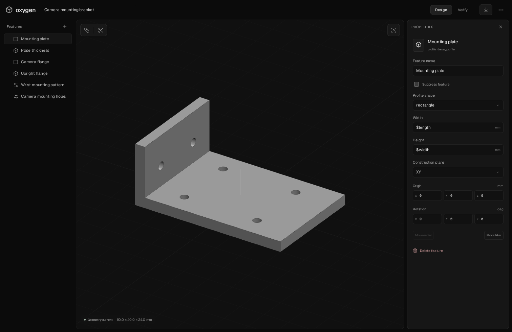

# Oxygen CAD

**A lean, local CAD IDE for coding agents and the people working with them.**

A Rust CAD engine. An editable text project. A JSON CLI. Our interactive studio. Your coding agent and your manual edits work on the same parametric model.

The workflow is familiar from code-driven creative tools such as Hyperframes and Remotion: author files, preview the result, inspect it, revise, and export. Here the output is exact CAD geometry, with measurements and engineering checks alongside the preview.



The studio uses [Oxygen Studio components](docs/UI.md): neutral dark and light themes, compact glass controls, quiet field focus, Geist typography and floating tools around the real CAD viewport. The sun/moon control switches themes and remembers your choice. The same components extend to engineering studies, history and source editing, with an adaptive layout on smaller screens. [Preview light mode](docs/studio-light.png).

## Apple Silicon desktop preview

The desktop app uses the same Oxygen interface, feature tree, property editor and review tools. A small Rust/Tauri launcher runs the CAD and simulation backend locally through Docker Desktop; it does not connect to the development server. Install and start Docker Desktop before opening the app.

The [CAD and browser checks workflow](https://github.com/OXYGEN-CRO/oxygen-cad/actions/workflows/ci.yml) builds an **Oxygen-CAD-Apple-Silicon** download artifact. The ZIP contains the test app and its local runtime. Unzip, move **Oxygen CAD.app** to Applications and open it. This preview is ad-hoc signed and not notarized; macOS may require **System Settings → Privacy & Security → Open Anyway** on first launch. Projects live under `~/Library/Application Support/io.oxygen.cad/projects` and survive app updates and closing Docker.

The initial runtime is Linux AMD64 because the pinned mesher stack has no Linux ARM64 wheels. Docker Desktop translates it on Apple Silicon. The app window is native ARM64; this is a local desktop preview, not a fully native standalone macOS solver distribution. See [desktop setup](docs/DESKTOP.md) for development and packaging.

## Quickstart

Requires Git and Docker with Compose. Linux x86_64 is tested. Apple Silicon uses the same amd64 images through Docker Desktop emulation; physical Mac validation is pending. The first image build downloads the CAD and analysis dependencies.

```sh
git clone https://github.com/OXYGEN-CRO/oxygen-cad.git
cd oxygen-cad
./o3d studio
```

Open **http://localhost:8787**. A camera mounting bracket is created automatically. Click **Build model** if geometry has not yet been generated. Select a feature, edit its dimensions, save, and rebuild. The default view keeps the model and searchable feature tree visible; selecting a feature or face opens its properties. Geometry controls appear first; expand Placement or Feature details for less frequent edits. Use the View menu for isometric/front/top/right views, `F` to fit, `M` to measure, `/` to find features, and `⌘S` / `Ctrl+S` to save. Breadcrumbs and panel icons collapse or expand either sidebar. The **⋯** menu opens **Study setup** for fit and stress tools and **Project settings** for naming, parameters and requirements, plus source, history, STEP import and agent commands. Save and rebuild controls appear when needed.

From another terminal in the repository:

```sh
./o3d doctor --json
./o3d inspect --json
./o3d context --json
./o3d check --json
./o3d render --json
./o3d export --json
```

The default project is `projects/demo/`. No account, built-in chat, or hosted backend is required. Model execution happens locally; your external coding agent retains its own network/data settings.

## Bundled agent skills

Oxygen CAD ships **14 focused skills**: setup, modelling, verification, parts search, PDF drawings, planar DXF, additive/process manufacturing review, SendCutSend preflight, URDF/SRDF/SDF, slicing and Bambu app handoff. They teach the actual CLI and provide standalone helpers over current exports. External applications and consumer checks remain explicit dependencies. The same `skills/` directory is bundled by the Claude Code and Codex plugin manifests.

For an agent workspace without the plugin, install the instructions with Python 3 on the host; Docker is not needed for this step:

```sh
./o3d skills list --json
./o3d setup --agent codex --workspace /absolute/path/to/workspace --dry-run --json
./o3d setup --agent codex --workspace /absolute/path/to/workspace --json
```

Use `--agent claude` for `.claude/skills`, or `--agent portable` for `.agents/skills`. Omit `--workspace` to install in this checkout. Setup can be rerun to update managed copies; it refuses to overwrite existing unowned skills or local edits. If the plugin already supplies the skills, use that route alone. See [agent setup and plugin installation](docs/AGENT-SKILLS.md).

## Discover off-the-shelf components

For custom-part production, the [manufacturing catalog](docs/MANUFACTURING.md)
adds sourced provider capabilities, process/material constraints and quote handoffs.
Public SendCutSend, Laserhub and ARK feeds can be ingested directly. Community JLC
snapshots support component discovery while official API approval is pending;
source dates and unknown availability remain explicit.

The optional [parts catalog](docs/CATALOG.md) adds PostgreSQL/pgvector discovery,
provider ingestion, sourced specifications, CAD assets and purchased/custom BOM
planning. Agents can search through a JSON CLI or REST/OpenAPI and import a
licensed STEP model through the CAD revision checks. Start it independently with
`docker compose -f catalog.compose.yaml up -d --build --wait` after setting the
catalog password as described in the guide. The initial real seed contains 17,325
provider records; stock and physical compatibility remain explicit unknowns.

## Work with a coding agent

Open this repository in Claude Code, Codex, or another coding agent. Ask it to follow `AGENTS.md` and the generated instructions in `projects/demo/AGENTS.md`.

For example:

> Inspect the camera bracket. Keep the mounting-hole diameter locked. Increase the plate length by 8 mm, rebuild it, check the measured dimensions, and render a preview for review.

The agent reads `o3d.json`, writes a proposal file, and applies it with an expected revision:

```sh
# Write the complete proposed document to projects/demo/proposal.json.
# The CLI runs in that project directory inside the container.
./o3d apply proposal.json --expected-revision 1 --actor agent \
  --summary "Extend the camera bracket"
./o3d build --json
./o3d check --json
./o3d render --json
```

Use the revision returned by `inspect`; `1` is only the initial example. A stale revision is rejected. User-locked parameters are protected. Browser selection is available through `context`, including the selected face, point, active feature, and geometry revision state. `inspect` returns measured geometry and face metadata without flooding the agent with triangle buffers.

Do not overwrite the live `o3d.json` directly. Apply proposal files through the CLI so revision checks, locks, and history remain effective.

## External workflow helpers

The bundle includes checksum-checked catalog downloads, a basic orthographic PDF sheet, planar DXF sections/inspection, sampled mesh and molding measurements, limited URDF/SRDF/SDF lint, Orca preset resolution/slicing plans and Bambu application handoff plans. These work on exported or external artifacts; they do not create native studio workspaces for every format. Process reviews cite current supplier rules and retain unmeasured checks. Robot lint does not establish simulator or physical correctness. Slicing and app handoff do not start a print.

Use the CAD Python environment for geometry helpers. The optional `.[skills]` extra adds ReportLab; native bootstrap and the Docker runtime include it. Setup itself remains Python-standard-library only. See [the workflow catalog and limits](docs/AGENT-SKILLS.md).

## What works

- **Native feature editing:** rectangle/circle/polygon profiles, construction planes, additive/subtractive extrusions, through/blind holes, rectangular hole arrays, fillets, chamfers, and placements.
- **One shared model:** GUI, JSON source editor, CLI, parameter references, locks, immutable revision snapshots, undo/redo, and restore.
- **Reference geometry:** content-addressed STEP imports with editable placement and visibility.
- **Review:** orbit/zoom, face selection, measurements between surface points, section view, exact dimensions, agent selection context, and PNG rendering.
- **Verification:** solid validity, connectedness, dimensions, mass with supplied density, reference interference/clearance, and an independent exported-mesh audit.
- **Simulation:** experimental real CalculiX static, modal, buckling, steady conduction and sequential thermal-stress studies; isolated Netgen/Gmsh meshing, explicit material/boundary inputs, refinement, balance checks, temperature/mode/stress/displacement fields and reproducible analysis artifacts. See [capabilities, evidence and parity ledger](docs/SIMULATION.md).
- **Handoff:** STEP, STL, project source, BOM CSV, and HTML/JSON engineering report in a revision-linked ZIP.
- **Local operation:** background jobs, cancellation, worker timeouts, recoverable job records, and explicit stale-result handling.

The initial modeling domain is brackets and mounts. Arbitrary executable Python projects, general constrained sketching, moving mechanisms, contact analysis, PCB/CAM, ordering, and live multiplayer are outside this release.

## Project format

The authoritative document is `o3d.json`. Geometry, meshes, solver results, and export bundles are derived artifacts under `.o3d/`. Imported STEP files live in `assets/` and are identified by their content hashes.

```json
{
  "name": "Sensor mounting plate",
  "parameters": {
    "thickness": {"value": 4, "unit": "mm", "locked": true}
  },
  "features": [
    {"id": "outline", "type": "profile", "width": 40, "height": 25},
    {"id": "plate", "type": "extrude", "profile": "outline", "distance": "$thickness"},
    {"id": "mount", "type": "hole", "diameter": 3.2, "center": [0, 0, 0]}
  ]
}
```

Dimensions use millimeters. Parameter references use `$name`; arbitrary expressions are not executed. The schema version is `1`. Native geometry references use semantic roles such as `part:xmin` when unique; other selections use strict signatures. Missing or ambiguous references require explicit repair.

See [the JSON Schema](docs/project.schema.json), [architecture](docs/ARCHITECTURE.md), and the [bracket](examples/bracket.json) and [numerical cantilever](examples/cantilever.json) examples.

## Static analysis

Define material elastic properties and their source, select fully fixed planar faces, select separate planar force regions, and enter total force vectors in newtons. Review the small-deflection, linear-elastic and static assumptions before running.

The solver uses mm, N, and MPa with quadratic tetrahedra and consistent distributed-load integration. Results retain the geometry, material, loads, mesh history, logs, and input revision. Changing analysis inputs invalidates affected results. A completed solve is distinct from passing an engineering requirement. Peak stresses at fixtures or sharp corners may be singular; the results do not certify physical strength.

The cantilever example supplies numerical benchmark inputs, not a production material certificate. In local verification, its 0.1589 mm displacement agrees with the analytical 0.1600 mm within 1%.

## Multiple projects

```sh
O3D_PROJECT_NAME=sensor ./o3d init
O3D_PROJECT_NAME=sensor O3D_PORT=8788 ./o3d studio
O3D_PROJECT_NAME=sensor ./o3d inspect --json
```

`O3D_PROJECTS_DIR` changes the host project directory. `O3D_PROJECT_NAME` selects a child project. Keep those settings consistent between the studio and CLI. The launcher supplies your UID/GID for project-file ownership.

## Development and tests

The supported reproducible runtime is the Docker image. It pins separate CAD and meshing Python environments because their OCCT versions differ.

```sh
docker build -t oxygen-cad .
docker run --rm oxygen-cad pytest -q
cd frontend
npm ci
npx playwright install chromium
# Point at a disposable running studio:
O3D_BROWSER_URL=http://127.0.0.1:8787 npm test
```

Browser tests edit their target project. Use a disposable project, not your working design.

For native Linux development, `scripts/bootstrap-native.sh` prepares the Python environments and frontend. Install the solver/runtime dependencies using the Dockerfile as the reference. `O3D_NATIVE=1 ./o3d ...` uses the local environment. With native setup available, `npm test` starts a disposable test server automatically.

Run `python scripts/generate_types.py` from the CAD environment after schema changes. This regenerates the frontend document types and checked-in JSON Schema.

The automated suite includes ten parts undergoing twenty alternating agent/human edits each, STEP round trips, lock/conflict behavior, history, reference integrity, load conservation, actual numerical analysis, and browser editing/export tests. See [validation status](docs/VALIDATION.md) for the exact evidence and remaining platform checks.

## Contributing

See [CONTRIBUTING.md](CONTRIBUTING.md). Reproducible geometric examples and measurements are especially useful. New feature types must be editable through both the project/CLI interface and the studio, and must participate in verification and invalidation.

## License

Oxygen CAD's original code is [MIT licensed](LICENSE). CAD, meshing, solver, UI, and font dependencies retain their own licenses; see [THIRD_PARTY.md](THIRD_PARTY.md). The Dockerfile fetches unmodified solver packages from Debian with pinned checksums.

## Vendored Rust engine

`third_party/solidcraft/` contains the actual headless SolidCraft source and required truck patches, pinned to `0520910bfd4ff6d24c850f4a20a604f6128f87bf`. Original copyright, MIT/Apache-2.0 licences, attribution and dependency notices are retained. `engine/` builds our small JSON-lines boundary; no upstream CLI download is used at runtime.

The default `geometry_engine` is `solidcraft`. Existing profiles, extrusions, holes, fillets and chamfers compile to the native engine. `type: "native"` features expose additional filesystem-free sketch/solid commands and remain editable in the same inspector and source document. OCCT independently checks STEP validity and volume, supplies review topology, and remains an explicit `geometry_engine: "occt"` compatibility option. Errors never silently select a different engine. Netgen/CalculiX verification remains in separate processes.

```sh
cargo build --release --locked --manifest-path engine/Cargo.toml
O3D_NATIVE=1 ./o3d engine commands --json
O3D_NATIVE=1 ./o3d engine describe solid.shell
```

The raw `o3d engine stdio` command provides a persistent local engine session for trusted developer tooling. Saved project features use a restricted modelling command set and cannot open/export arbitrary files. See [engine architecture](docs/ENGINE.md) and [third-party notices](THIRD_PARTY.md).
