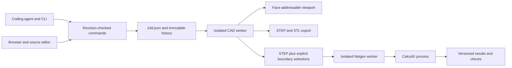

# Architecture

The editable engineering document is the source of truth. Exact solids, display meshes, numerical models, results and release files are derived artifacts.

## Responsibilities

- `model.py`: versioned Pydantic project, feature, material, requirement, study, finding and command types. No executable expressions or user-provided Python.
- `store.py`: process-safe file locking, optimistic revision checks, parameter locks, atomic saves, immutable snapshots, undo/redo/restore and invalidation-aware state.
- `geometry.py`: native operation compilation, exact geometry, semantic/strict face references, STEP assets, measured checks and independent STL audit.
- `mesh_worker.py`: a standalone script in the Netgen environment. STEP region transfer requires a unique area/centroid match. Quadratic tetrahedral node order is explicitly converted for CalculiX.
- `solver.py`: study preflight, consistent planar traction loading, solver decks/results, mesh refinement, equilibrium checks and cancellation-aware subprocesses.
- `jobs.py` and `worker.py`: queued jobs in killable processes, durable job records and restart recovery. Child solver processes receive cancellation.
- `api.py` and `cli.py`: the same application model and Store; local HTTP service, JSON CLI and artifact delivery.
- `frontend/src/`: browser model review, native feature editor, source editor, study setup, field visualization and history.

## Interfaces

Project schema version: `1`. Length: mm. Force: N. Stress and elastic modulus: MPa. Density input: g/cm³. Material values require an explicit source.

`Command` carries `expected_revision`, `actor`, `action`, the proposed `project` or a history revision, and a summary. Stale revisions and agent edits to locked parameters are rejected. History operations create new revisions.

Core HTTP routes: `GET /api/state`, `GET /api/project`, `GET /api/schema`, `POST /api/commands`, raw STEP upload through `POST /api/import`, job submission/status/cancellation, artifact retrieval and selection context. `/api/events` exposes project/job changes as server-sent events. The current studio uses bounded polling to refresh these states.

Native extreme-face roles such as `part:xmin` are available only when unique. Other faces use strict geometric signatures. Import assets are immutable and hashed; their face identities are scoped to that exact asset. Replacing geometry never silently remaps a lost selection.

Geometry, verification and study hashes cover their respective inputs. Parameter-lock/view changes do not invalidate physics; material, loads, supports, geometry and relevant requirement changes do. Failed builds keep a visibly stale previous preview, while export requires successfully built current geometry.

## Runtime

Docker packages Python 3.12 with separate CAD and mesher environments and an external CalculiX executable. amd64 images are used on Linux and through Docker Desktop emulation on Apple Silicon. The service binds to loopback through Compose, restricts trusted host names and rejects foreign-origin writes. Only the selected project directory is mounted.

The app does not own an LLM connection. An existing coding agent uses ordinary files, CLI output and PNG artifacts. No model credentials are stored by the application.
