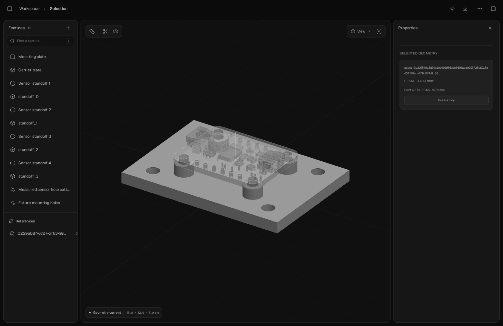
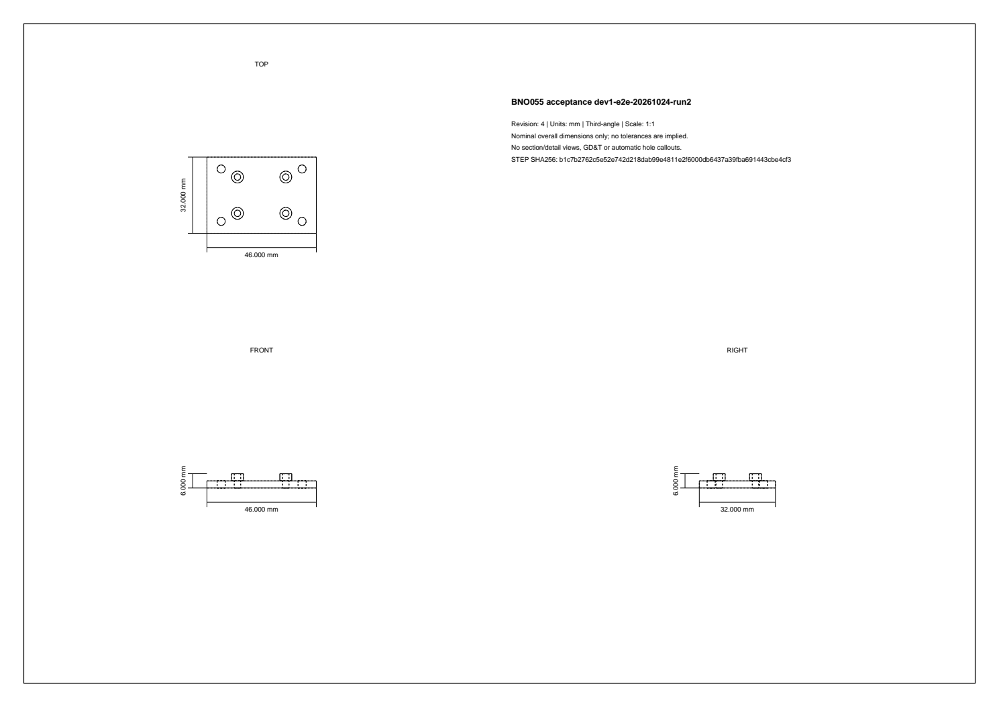

# Revision-bound handoff

Build the selected project, run the checks/studies required for the task, then create the combined package:

```sh
./o3d build --json
./o3d check --json
# Run simulate only with supplied engineering inputs and reviewed assumptions.
./o3d handoff create --section-z 1.5 --json
./o3d handoff status --json
```

`--section-z` is required: choose a horizontal project-coordinate plane in millimeters that intersects the part. The optional `--overhang-degrees` screening angle defaults to 45; select an applicable process rule before interpreting it as a limit. The CAD environment needs the `skills` extra. These commands use the same project selection as the studio and standard export.

The returned artifact/report paths resolve under the project's `.o3d/`. Each generation has a separate folder and ZIP. It contains:

- The existing native release, source document, BOM, STEP/STL and any current analysis evidence.
- Imported reference STEP files, accompanying license/catalog sidecars and catalog-link provenance, preserving project-relative paths.
- A nominal orthographic PDF, planar DXF section, mesh screen and PNG preview.
- An HTML entry point, engineering findings and a manifest binding source revision/document hash, reference bytes, generator files, package versions, native-engine binary and every packaged output.

`current` is a freshness result. Read `findings` separately: export may contain failed geometry checks or stale/absent analysis. The drawing has nominal overall dimensions without hole callouts, tolerances, sections or GD&T. The DXF is a section, not an unfolded sheet. The mesh screen does not establish complete wall/tool-access analysis. Supplier acceptance, physical fit/strength, robot consumers and slicing/printing remain separate checks.

Status exits 2 for stale/not-run results. A changed model, reference/notice, generator or packaged file makes the recorded package stale. Cached ZIP and manifest hashes are checked against a detached receipt. This detects local accidental changes; it is not a cryptographic signature or external trust service. An old package remains stale after a newer one is generated:

```sh
./o3d handoff status --manifest handoffs/r3-example/manifest.json --json
```

Unpack the ZIP into a separate directory to reopen its `o3d.json` and imported assets. Select that project in the CLI/studio; run `handoff status --manifest manifest.json --json` to check the unpacked files. The outer ZIP check does not apply to unpacked files. Rebuilding is separate from rerunning analysis. Keep the original native package for raw solve evidence; it is not restored as an active solver cache automatically.

Generation does not modify the project or solve physics. A source change during generation is refused, failed derivative diagnostics are retained, and an unsuccessful generation leaves the previous successful pointer intact.

# Real sensor-mount acceptance

`scripts/accept_sensor_mount.py` runs a fresh-project acceptance case against an existing configured native runtime and catalog. It installs the fourteen skills into a new agent workspace, searches/fetches/imports an MIT-licensed Adafruit BNO055 Stemma STEP, measures the PCB and its mounting holes, and places it on the supplied carrier fixture. It rejects stale proposals and locked-hole edits, builds/checks/solves, then starts its own isolated studio and drives actual Chromium editing and face selection. After widening the plate it verifies stale analysis/handoff state, reruns the solve, regenerates, unpacks/rebuilds and renders the PDF with PDFium. It stops its studio on exit and retains logs/screenshots/results.

Prepare the CAD/mesher/native-engine/CalculiX runtime as in the main README; install the optional acceptance PDF renderer and frontend browser dependencies:

```sh
.venv/bin/python -m pip install -e '.[skills,acceptance]'
cd frontend
npm ci
npm run build
npx playwright install chromium
cd ..
# Set O3D_ENGINE_BINARY, O3D_MESH_PYTHON, CCX_BINARY and library paths as needed.
# o3d-parts must already address your configured seeded catalog.
.venv/bin/python scripts/accept_sensor_mount.py \
  --output /absolute/path/to/new-acceptance-directory \
  --catalog-cli o3d-parts --port 19766
```

The output directory must be new/empty, and the chosen port must be free. No credential values belong in the command or reports. The catalog needs the BNO055 Stemma record with its licensed STEP asset; source changes or unavailable downloads cause an explicit failure.

On 2026-10-24 this case passed all 23 steps on Linux host `dev-one`. The carrier changed from 42 × 32 × 6 to 46 × 32 × 6 mm; the 2.7 mm locked carrier-hole parameter was preserved. The source PCB measured 25.4 × 20.32 × 1.57 mm with four 2.5 mm holes. Geometry checks found one connected solid and zero modeled overlap with the reference. Two real numerical static solves passed under the fixture's explicitly synthetic material/load inputs. Those inputs are a software test, not a production material certificate or strength validation. The final ZIP reopened, rebuilt and passed the unpacked freshness check, and PDF text/rendering showed the edited dimensions.

This is a scripted acceptance run with real CAD, catalog, solver and browser operations. It reuses an installed runtime and supplies the fixture/workflow; it does not establish cold-install behavior or independent agent skill discovery. It does not exercise macOS/Windows, external slicer/robot consumers, fabrication or physical fit.





Sensor geometry attribution: [Adafruit CAD Parts, BNO055 Stemma](https://github.com/adafruit/Adafruit_CAD_Parts/tree/c128bceb1f96b6ea8b68f250bda986ba85da24ea/4646%20BNO055%20Stemma), MIT license; the fetched asset and its notice remain with each acceptance project/package. The source STEP SHA-256 is `3b224549a3d24c1ec4b0966dae6603aea0293f25b8215ad3f176acaf79c074d9`. The sensor is reference geometry, not a native editable PCB or an electrical design validation.
