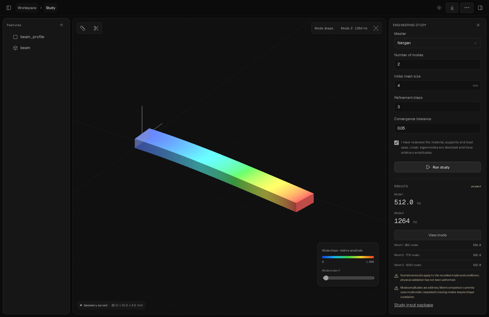
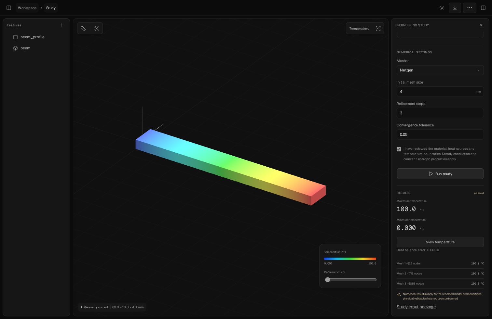
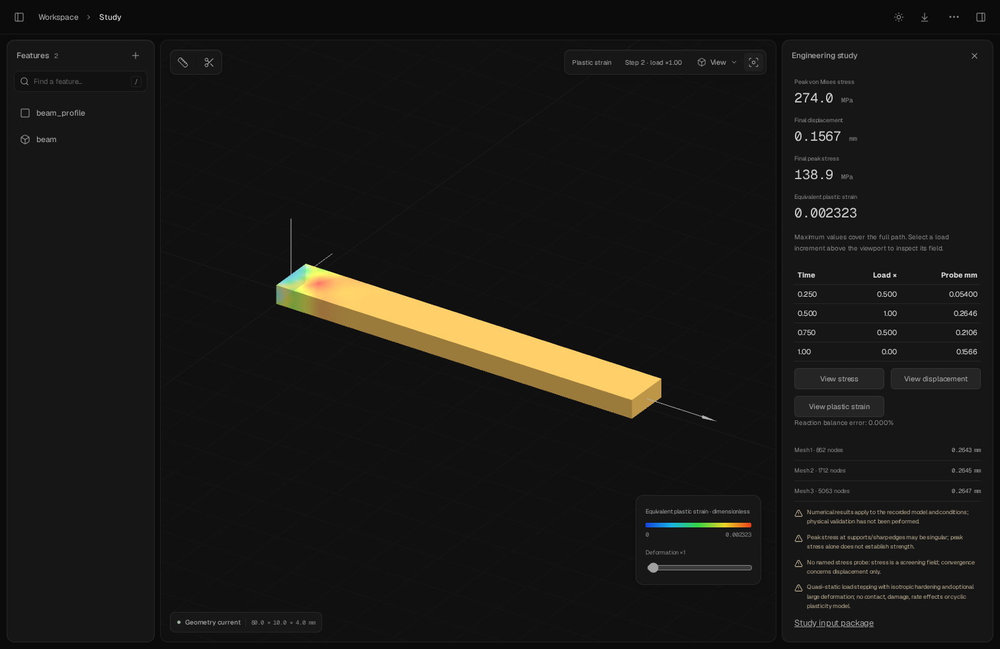

# Validation status

This is an early open-source CAD IDE, not a claim of complete CAD or engineering-analysis coverage.

## Verified in the Linux development environment

- 29 backend tests pass with the Rust compiler, including ten mounting-plate dimension variants with twenty alternating human/agent edits each, measured volume/dimensions and STEP re-import after every edit.
- Lock enforcement, concurrent revision conflicts, undo/redo, invalid input rejection, semantic-reference preservation and explicit strict-reference failure.
- STEP asset integrity, actual interference detection, independent exported-mesh checks and stale-export rejection.
- Quadratic boundary-load integration preserves total force and applied moment.
- A real CalculiX 2.23 cantilever solve, using Netgen meshing, predicts 0.1589 mm maximum displacement versus the analytical 0.1600 mm. Mesh refinement converges; force and moment balance errors are below 1%.
- Six Playwright flows cover native property editing, save/rebuild/check/export, real viewport selection reaching agent context, source editing/persistence protection against overwriting a concurrent agent revision, and an actual browser-run stress study with field visualization. The additional appearance and accessibility-of-tools flows cover dark form controls, actual production glass blur, menu navigation and no page overflow across Design, Verify, History and Source at 320/390/768/1024/1512px.
- Production frontend build and the Docker image build complete successfully. All 23 backend tests also pass inside the Python 3.12 Docker runtime, including the real numerical solve.

## Dark glass integration (2026-10-24)

The production frontend build and formatting check passed. All 23 backend tests passed natively. All five browser flows passed against a dedicated disposable project and a frozen copy of the production assets; the live working project was not used for acceptance tests. The updated production frontend is served by the existing local studio. This update does not claim a fresh Docker image build or physical Safari/macOS validation.

## Graphite refinement (2026-10-24)

The monochrome refinement passes the production build, formatting/whitespace checks, 23 native backend tests, and all five browser flows on a fresh disposable project (34.9 seconds). Appearance coverage verifies neutral black/grey surfaces and actual Geist font loading in all four views at 320/390/768/1024/1512px. A local unsaved edit exposes the real Save action and verifies dark, neutral, gradient-free backgrounds at rest and on hover without changing the engineering document. Functional flows continue to cover real geometry, export, concurrent revision protection and a numerical stress study. Font license notices ship with the static assets.

## Breadcrumbs and sidebar navigation (2026-10-24)

The compact breadcrumb header removes branding, the project-title input, mode tabs and generic face-selection guidance. All six browser flows passed (35.6 seconds) on an isolated disposable project; 23 backend tests passed (14.35 seconds), together with the production build, formatting and whitespace checks. Sidebar coverage measures reclaimed canvas width, keyboard toggling, breadcrumb toggling, inspector collapse/reopen with unsaved input preserved, study access, mobile controls and unchanged engineering documents. Existing editing/export, revision-conflict and real static-study checks still pass through the new menu navigation. Project naming is tested through Project settings.

## Pending external validation

- Physical Apple Silicon/macOS execution and performance measurements. Docker Desktop emulation is the intended path, not proof that the platform has been tested.
- Real design-partner onboarding, time-to-completion, manufactured fit and correlation against physical deflection measurements.
- Broader topology changes, large imported assemblies, and geometries beyond the bounded native feature set.

## Numerical boundaries

The experimental workflows now include single-solid isotropic linear static, unloaded modal, ideal eigenvalue buckling, steady conduction and sequential thermal stress through CalculiX and isolated Netgen/Gmsh meshers. [Simulation scope and implementation ledger](SIMULATION.md) records the exact inputs, units, tests and remaining work. No contact, bolt preload, impact, fatigue or calibrated additive-material model is implied.

Mesh convergence is reported for displacement and, when supplied, the named stress probe. Unconverged or unbalanced studies are inconclusive. Stress peaks at constraints or sharp corners may be singular. Exported reports retain these qualifications and the exact inputs.

## Rust core and desktop integration (2026-10-24)

- The vendored Rust core and Oxygen JSON-lines executable build from source with Rust 1.95 and a pinned Cargo.lock. No downloaded upstream executable supplies the application engine.
- All 29 backend tests pass with Rust as the default, including 200 alternating edits, native shell/STEP/native-container export, transformed coordinate frames/placements checked against the explicit OCCT compiler, protected nested bindings, filesystem-command rejection, and the actual mounting-bracket geometry.
- All six browser flows pass against a fresh fixture, including editing a Rust-native shell through the same UI and measuring the rebuilt volume. The real static study and field visualization continue to pass.
- OCCT remains an independent STEP/volume validator and an explicit compatibility backend; Netgen/CalculiX remain separate processes. Broader upstream functionality and universal kernel robustness are not inferred.
- The desktop launcher preserves the current React studio and packages a local Docker runtime. Apple Silicon artifacts are built on macOS CI; Linux native-window smoke verification and macOS build results are recorded separately from physical Mac testing.

## OXYGEN component patterns and dual themes (2026-10-24)

The existing studio now has complete neutral dark/light themes, a persistent sun/moon switch, quiet field focus and a Radix project-tools menu. The OXYGEN reference was inspected read-only; the CAD styling is an original neutral adaptation using open-source primitives.

All nine browser flows passed on the final production assets against a disposable fixture at port 19516 (49.6 seconds). They cover both themes across four views and 320/390/768/1024/1512px, actual WebGL clear-color changes, renderer identity, preference persistence, unsaved input preservation, pointer/keyboard focus without an outer halo, menu arrow keys/Escape/focus return, sidebar navigation, native editing/export, revision conflicts and a real Netgen/CalculiX study. All 29 backend tests passed (38.85 seconds); production build, formatting and whitespace checks passed. Final live read-only screenshots show dark/light property panels and the light mobile menu, with zero runtime errors or page overflow. No acceptance test edited the live working design. Physical macOS/Safari, human visual acceptance and extended-session usability remain unclaimed.

## Mechanical and thermal study expansion (2026-10-24)

The integrated source passes 49 backend tests (61.84 seconds); 14 optional database-backed catalog cases were skipped because no disposable PostgreSQL test database was configured. Eleven browser flows pass together (1.1 minutes), including actual modal and thermal solves, mode/temperature rendering, saved settings, result invalidation, native-command edits, revision protection, themes and release. Frontend production build, TypeScript, formatting and authored-source whitespace checks pass.

Numerical references include cantilever static displacement within 2% and a nonsingular stress probe within 5% through both Netgen and Gmsh, modal frequency against beam theory, Euler fixed-free buckling, one-watt conduction/probe/heat balance through both meshers, and sequential thermal expansion. An actual CLI thermal example initializes, solves to 100 °C with heat-balance error below 1e-12, and exports a release. Input-package paths, exact STEP, meshes, decks, raw outputs and normalized fields are inspected in release ZIP tests.

Earlier worktree runs exposed a worker import-path issue and browser fixture assumptions. Workers now load the same application source revision as their parent; new numerical browser tests restore the disposable project, and existing tests accept already-current cached geometry. The passing results above are from the corrected integrated source, not the earlier runs.

Prepared physical correlation protocol: [PHYSICAL-VALIDATION.md](PHYSICAL-VALIDATION.md). No physical specimen, external solver comparison, Windows/macOS execution or full Fusion parity is established. [SIMULATION.md](SIMULATION.md) retains every remaining branch and validation requirement.

## Precision workspace for CAD designers and engineers (2026-10-24)

The studio refinement adds a searchable feature navigator, geometry-first inspectors with native expandable Placement/Feature details, actual isometric/front/top/right camera views, fit with zoom reset, keyboard shortcuts, accessible tooltip hints and explicit unsaved state. Both neutral themes and restrained focus remain.

All thirteen browser flows passed on the final production build against the disposable fixture at port 19526 (1.2 minutes). New checks verify filtering and empty/clear states, opening a hidden navigator with `/`, preserved disclosure drafts, typing guards, rendered projection differences without replacing the canvas, fit restoring the exact previous standard-view image after zoom, tooltip shortcut hints and actual revision-protected keyboard saves. The native shell test saves directly from its JSON buffer with Command/Ctrl+S and verifies rebuilt volume. Existing static, modal and thermal numerical browser workflows, concurrency, export, themes and responsive navigation pass together. All 63 backend tests passed (65.94 seconds); 14 optional catalog database cases were skipped because no disposable database URL was configured. Production build, formatting and whitespace checks pass.

Read-only visual inspection of the running studio covered dark/light desktop, actual top projection and a 390px light inspector, with zero runtime errors or page overflow. Acceptance tests used disposable projects. This is Linux Chromium evidence; physical macOS/Safari execution, human visual acceptance and usability with professional CAD designers remain separate validation.

## Saved studies and nonlinear load paths (2026-10-24)

The combined source retains the precision-workspace changes and passes **70 backend tests**, with **14 optional catalog database cases skipped**, in 120.04 seconds. All **15 browser flows pass** together in 1.8 minutes on a disposable project, including configuring plastic hardening, loading/unloading, verifying the selected increment artifact and rendering its plastic-strain field. Production build/TypeScript, formatting, Python compilation, whitespace and the bundled verification-skill validator pass. A dependency deprecation warning does not affect these outcomes.

Named-study tests measure doubled-load response, independent invalidation, preserved primary inputs, revision conflicts, scoped requirement evaluation, current-result comparisons and multi-study releases. Names alone preserve numerical signatures. Stale studies are excluded from release packages, and repeated exports use new directories. Exported result and history references resolve within the ZIP. Unsaved changes hide previous numerical fields and summaries.

Real nonlinear benchmarks compare a large-deflection cantilever with an independent elastica boundary-value solution (2% gate), and a synthetic isotropic-hardening axial bar with analytical peak extension and permanent set (3%/4% gates). Four-versus-eight load increments agree within 1%; force and moment residuals remain below 1%. A peak-displacement requirement fails even when the unloaded residual lies below its limit. Missing curve sources, incompatible physics and incomplete observation histories refuse. Hardening-range exceedance is inconclusive; incomplete plastic-strain fields refuse. These are numerical checks of synthetic/reference problems, not calibrated production materials.

The CLI initializes the `plastic-unload` template, solves the complete eight-observation path, clones an independently unrun study and exports the solved default study under `analyses/default/`. Its peak extension is approximately 0.2647 mm and final permanent set 0.1567 mm, versus analytical values 0.2680/0.1600 mm under the stated synthetic assumptions. The report retains the unsolved clone as not run.

Six study types now have executable experimental subsets. No contact, damage, cyclic calibration, independent second FE solver, physical test, Windows/macOS runtime execution or complete Fusion parity is established. The remaining completion requirements stay open in [SIMULATION.md](SIMULATION.md).
